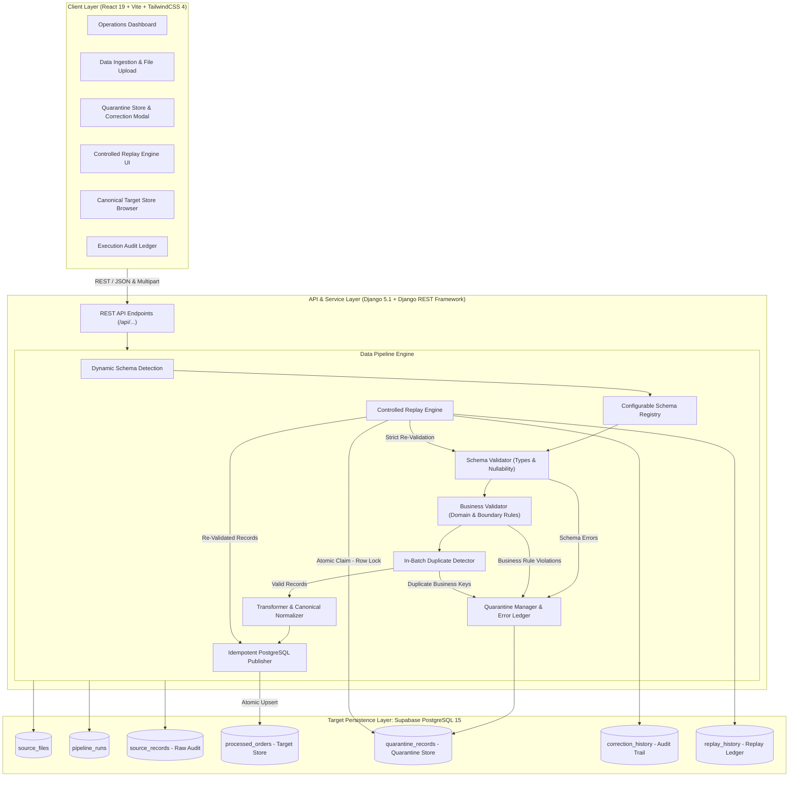
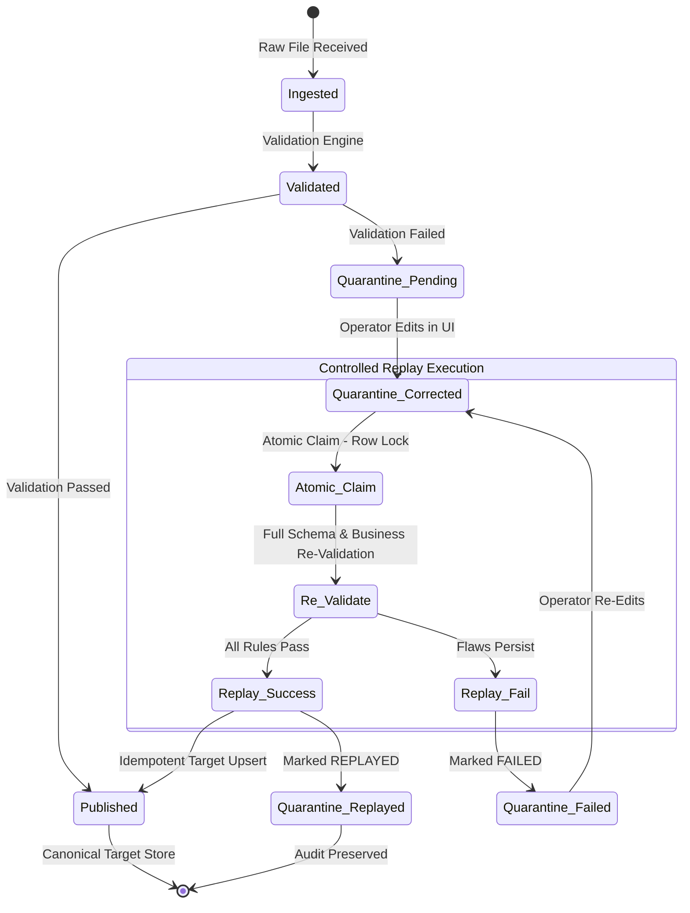

# Data Quality & Recovery Pipeline: Architecture

## 1. System Overview

The **Data Quality & Recovery Pipeline** is an enterprise-grade, multi-schema data engineering application designed to ingest structured datasets, enforce strict schema and business rule validation, quarantine non-compliant records, and provide controlled, selective recovery without reprocessing previously successful records.

The pipeline is completely domain-agnostic, supporting multiple data schemas (including Generic Events, Industrial IoT Asset Telemetry, and Commercial Transaction records) through a centralized, configurable **Schema Registry**.

### High-Level Architecture Diagram

---

## 2. Ingestion & Validation Pipeline Workflow

1. **File Ingestion & Fingerprinting**:
   - Accepts CSV and JSON payloads via `POST /api/ingestion/upload/`.
   - Generates deterministic SHA-256 fingerprint to ensure file integrity and prevent redundant storage.
   - Registers entry in `source_files` table with file metadata and size.

2. **Dynamic Schema Detection**:
   - Inspects file headers without hardcoded assumptions.
   - Matches column sets against the `SchemaRegistry` to automatically bind the correct schema definition:
     - **Asset Telemetry**: `reading_id`, `asset_code`, `metric_name`, `metric_value`, `unit`, `observed_at`, `quality_flag`
     - **Generic Events**: `record_id`, `entity_id`, `event_type`, `amount`, `quantity`, `event_timestamp`, `status`
     - **Transaction Records**: `order_id`, `customer_id`, `product_name`, `quantity`, `unit_price`, `total_amount`, `order_date`, `order_status`

3. **In-Batch Duplicate Detection**:
   - Enforces uniqueness on the active schema's unique identifier (`reading_id`, `record_id`, or `order_id`).
   - Allows repeated domain entity codes (e.g., repeated `asset_code` values are valid time-series observations).
   - Flags duplicates immediately with `ERR_DUPLICATE_RECORD_ID`.

4. **Two-Stage Validation Engine**:
   - **Schema Validation**: Verifies mandatory fields, non-null constraints, data types (integer, decimal, timestamp, date), and ISO-8601 formatting.
   - **Business Rule Validation**: Enforces numerical boundaries (e.g., humidity `0–100%`, vibration `>= 0`), metric-specific unit matching (e.g., pressure must be `kPa`, not `psi`), status enums, date range boundaries (2000–2100), and calculation integrity.

5. **Deterministic Bifurcation**:
   - **Valid Stream**: Transformed into canonical UTC ISO-8601 timestamps and precise decimal types, then bulk upserted into `processed_orders`.
   - **Quarantine Stream**: Captured verbatim with raw payload, source file, source row number, and structured error breakdown into `quarantine_records`.

---

## 3. Controlled Selective Replay Architecture

The foundational recovery guarantee is that **previously successful records are never reprocessed during recovery operations**.

### Recovery Guarantees:
1. **Strict Selection**: Replay queries only target records with `status = 'CORRECTED'`. Records already in `REPLAYED` or untouched `PENDING` status are ignored.
2. **Atomic Concurrency Protection**: Uses `select_for_update(skip_locked=True)` within Django `transaction.atomic()` blocks to prevent double-claiming by concurrent workers.
3. **Audit Immutability**: Every edit appends a full diff record to `correction_history` documenting changed fields, previous values, new values, operator ID, and timestamp.
4. **Target Idempotency**: Target store insertions utilize PostgreSQL `ON CONFLICT (order_id) DO UPDATE` to ensure zero duplicates upon replay.
