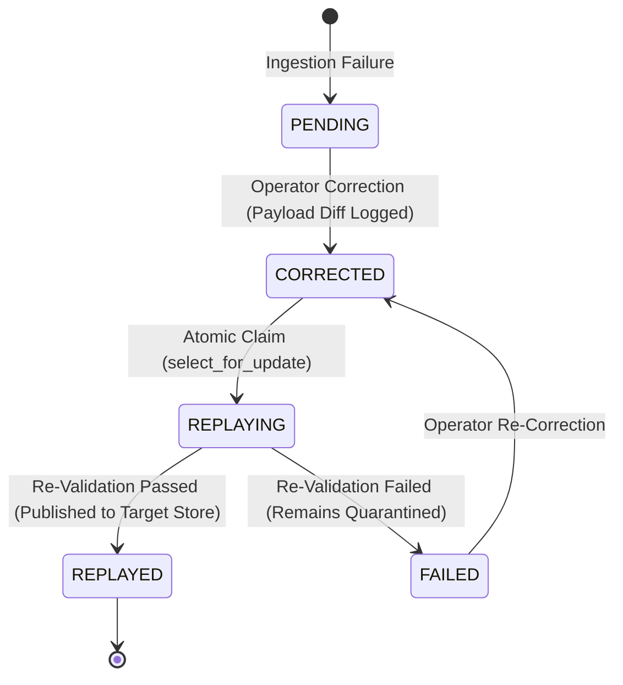

# Architecture Decision Records & Technical Trade-offs

This document provides a formal Architecture Decision Record (ADR) log for the **Data Quality & Recovery Pipeline**, detailing the architectural choices, trade-offs, and alternatives considered for every major subsystem.

---

## ADR 01: Multi-Schema Registry vs. Dedicated Per-Schema Pipelines

### Context
Initial iterations of the pipeline were tightly coupled to e-commerce transaction fields (`order_id`, `customer_id`, `unit_price`, `total_amount`), which caused generic data streams and industrial IoT telemetry (e.g., `reading_id`, `asset_code`, `metric_value`) to be completely rejected into quarantine with `ERR_MISSING_FIELD`. The system required multi-tenancy across schemas without duplicating pipeline code or requiring bespoke pipeline deployments per dataset.

### Decision
Implement a centralized, declarative **`SchemaRegistry`** pattern (`backend/data_pipeline/schemas.py`).
- Schemas are defined as declarative configurations specifying required columns, data types, nullability, unique identifiers, enum constraints, and domain-specific validation rules.
- Supported schemas include:
  1. **Generic Event Records**: `record_id`, `entity_id`, `event_type`, `amount`, `quantity`, `event_timestamp`, `status`.
  2. **Asset Telemetry (Industrial IoT)**: `reading_id`, `asset_code`, `metric_name`, `metric_value`, `unit`, `observed_at`, `quality_flag`.
  3. **Commercial Transaction Records**: `order_id`, `customer_id`, `product_name`, `quantity`, `unit_price`, `total_amount`, `order_date`, `order_status`.
- **Dynamic Signature Matching**: At ingestion time, the pipeline inspects uploaded column headers and selects the matching schema using column overlap scoring. An explicit `schema_name` parameter can also override autodetection.

### Trade-offs & Alternatives Considered
- *Alternative 1: Separate Django apps or standalone microservices per schema.* Rejected due to massive code duplication, higher maintenance overhead, and fragmented operational dashboards.
- *Alternative 2: Schema-less NoSQL storage (MongoDB/DynamoDB).* Rejected because data engineering pipelines downstream require strict relational guarantees, ACID consistency, and relational reconciliation.
- *Trade-off*: A generalized target relational schema (`processed_orders`) stores canonical fields alongside schema-specific fields and the raw payload JSONB. This allows uniform queries, reconciliation, and indexing while preserving schema-specific integrity.

---

## ADR 02: Two-Stage Validation Architecture (Syntactic vs. Semantic)

### Context
Data quality failures fall into two distinct categories: structural syntax defects (e.g., non-numeric strings in integer columns, missing mandatory keys, malformed timestamps) and semantic business rule violations (e.g., negative amounts, humidity exceeding 100%, mismatched engineering units, unreferenced foreign keys). Mixing these checks creates brittle monolithic validation code that produces misleading error messages.

### Decision
Decouple validation into two distinct, sequential stages:
1. **Stage 1: Syntactic Schema Validation (`SchemaValidator`)**:
   - Validates column presence, nullability, data types (integer, decimal, ISO-8601 timestamps), string lengths, and basic format compliance.
   - Prevents downstream runtime crashes by ensuring data frames or records match expected structural types.
2. **Stage 2: Semantic Business Rule Validation (`BusinessValidator`)**:
   - Enforces business boundaries (e.g., humidity `0.0–100.0%`, temperature `-50.0–150.0°C`, vibration `>= 0.0 mm/s`, amount `>= 0.00`).
   - Validates engineering units against metric names (e.g., `pressure` must use `kPa`, `vibration` must use `mm/s`).
   - Validates enum membership for lifecycle statuses and event types.
   - Cross-checks arithmetic consistency (e.g., `total_amount == quantity * unit_price`).
   - Flags in-batch duplicate business keys while permitting legitimate time-series repeats (e.g., repeated `asset_code` readings across different timestamps).

### Trade-offs & Alternatives Considered
- *Alternative: Pydantic alone for all validation.* Pydantic is exceptional for record-level schema typing, but pure Python object instantiation creates significant CPU bottlenecks on batches of 100,000+ records. Combining Pandas vectorization for batch parsing with targeted Pydantic/Python rule engines yields optimal throughput (200+ rec/s over remote Supabase).

---

## ADR 03: Controlled Selective Replay vs. Full Batch Reprocessing

### Context
In traditional ETL/ELT pipelines, correcting a batch of bad records often requires either reprocessing the entire source file (risking duplicate writes, recalculations, or race conditions) or manually crafting custom SQL scripts to update production tables. The core requirement here was: **reprocess only corrected records, without touching or re-evaluating previously successful records, and ensure absolute idempotency.**

### Decision
Implement an isolated, stateful **Quarantine and Controlled Replay Engine** (`ReplayEngine`):
- Non-compliant records are diverted to `quarantine_records` with status `PENDING`, preserving the verbatim JSONB raw payload, source row number, source file, and granular error list.
- Operators review and correct records via the UI or API (`PATCH /api/quarantine/<id>/correct/`), transitioning status to `CORRECTED` and logging full diffs in `correction_history`.
- Replay is **selective**: it strictly targets records where `status = 'CORRECTED'` (or an explicit list of IDs). Records with status `REPLAYED` or `PENDING` are strictly excluded from selection.
- **Atomic Locking**: Replay uses PostgreSQL row-level locking (`SELECT ... FOR UPDATE SKIP LOCKED`) within an ACID transaction boundary (`transaction.atomic`) to prevent duplicate execution across concurrent workers.
- **Strict Re-Validation**: Corrected records are passed through the exact same two-stage validation pipeline. If flaws remain, the record transitions to `FAILED` and stays in quarantine. If valid, it is transformed and published to `processed_orders` via PostgreSQL upsert, its quarantine status transitions to `REPLAYED`, and an audit record is committed to `replay_history`.

---

## ADR 04: Idempotency & Conflict Resolution (`ON CONFLICT DO UPDATE`)

### Context
Network retries, duplicate file uploads, manual replays, and concurrent workers can introduce duplicate records into the target persistence store or duplicate quarantine entries, corrupting business analytics and metrics.

### Decision
Enforce multi-layered idempotency guarantees across the pipeline:
1. **Target Store Idempotency**:
   - The primary key `order_id` in `processed_orders` stores the canonical business identifier (`reading_id`, `record_id`, or `order_id`).
   - Insertion is executed via PostgreSQL atomic upsert (`INSERT ... ON CONFLICT (order_id) DO UPDATE`), updating attributes and setting `processed_at = NOW()` rather than failing or creating duplicate rows.
2. **Quarantine Idempotency**:
   - Quarantining checks the unique combination of `(source_file, source_row_number, run_id)` before insertion. Repeated execution of the same run will not generate duplicate quarantine entries.
3. **Replay Idempotency**:
   - The replay engine filters explicitly by `status = 'CORRECTED'`. Once a record is successfully replayed and published, its status becomes `REPLAYED`. A subsequent replay trigger ignores it entirely, resulting in 0 processed, 0 duplicated.
4. **Source File Fingerprinting**:
   - File uploads compute a SHA-256 hash. If an identical file has already been processed, the system links to the existing `SourceFile` record rather than creating orphan metadata.

---

## ADR 05: Persistence Layer Choice: Supabase Managed PostgreSQL

### Context
The persistence tier required strong relational integrity, ACID transaction boundaries, complex JSONB querying for raw payloads and validation error trees, and production-grade remote cloud hosting.

### Decision
Adopt **Supabase Managed PostgreSQL 15**:
- **ACID Transactions**: Required for atomic batch publishing, where partial failures within a batch can be rolled back cleanly or committed deterministically.
- **Native JSONB with GIN Indexing**: Raw payloads (`raw_payload`, `raw_record`), operator correction diffs (`changed_fields`), and multi-error arrays (`validation_errors`) are stored as native JSONB. This allows querying deep JSON properties directly in SQL while preserving raw source fidelity.
- **Row-Level Locking**: Enables `select_for_update(skip_locked=True)` to power concurrent, worker-safe replay queues without distributed lock managers like Redis/Zookeeper.
- **Cloud Managed Reliability**: Automated backups, SSL-enforced connections (`sslmode=require`), and database health monitoring.

---

## ADR 06: Processing Framework & Performance Optimizations

### Context
Processing batches ranging from 100 to 100,000+ records over a remote cloud database connection introduces latency bottlenecks if done row-by-row through traditional ORM save loops.

### Decision
Implement a hybrid processing architecture:
1. **Pandas & PyArrow Vectorization**:
   - Files are parsed using Pandas backed by PyArrow engines for rapid, memory-efficient columnar ingestion.
   - Batch-level duplicate detection uses vectorized Pandas indexing (`df.duplicated(subset=[key_col], keep=False)`).
2. **Chunked Memory Streaming**:
   - Datasets exceeding memory thresholds are streamed in chunks (`chunksize=5000`) to guarantee a constant $O(1)$ memory footprint regardless of file size.
3. **Bulk Database Operations**:
   - Instead of individual `Model.save()` calls in a loop, records are written using bulk operations (`bulk_create` with batch sizes of 1,000, or batched parameter SQL upserts).
4. **Targeted PostgreSQL Indexes**:
   - B-tree indexes placed on `(status, error_code)`, `run_id`, `source_file`, `observed_at`, and `event_timestamp`.
   - GIN indexes on `raw_record` and `validation_errors` JSONB columns for fast diagnostic search.

### Measured Benchmarks (Live Supabase Cloud)
- **100 records**: Ingested in 1.745s (57.3 rec/s)
- **1,000 records (Generic)**: Ingested in 6.011s (166.4 rec/s)
- **1,000 records (Telemetry)**: Ingested in 4.950s (202.0 rec/s)
- **5,000 records (Telemetry)**: Ingested in 23.927s (209.0 rec/s)

---

## ADR 07: Frontend Architecture: React 19 + Tailwind v4 + Recharts

### Context
The operational UI must provide real-time visibility into pipeline throughput, quarantine triage, error cause analysis, and controlled replay workflows without requiring full-page reloads.

### Decision
Build a Single-Page Application (SPA) using:
- **React 19** + **Vite 8**: Sub-second Hot Module Replacement (HMR) and optimized static production builds (`frontend/dist`).
- **TailwindCSS 4**: Utility-first responsive styling with clean dark/light mode surface tokens and zero runtime CSS overhead.
- **Recharts**: Declarative, responsive SVG charting for reconciliation balance bars, quarantine error Pareto charts, and data quality trend lines.
- **Lucide React**: Consistent, lightweight operational iconography.
- **Axios with Global Error Interceptors**: Standardized API response parsing, loading state dispatching, and unified error notifications.
